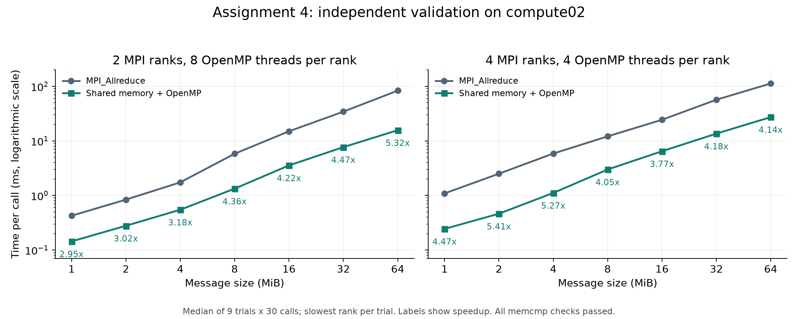

# Assignment 4: shared-memory Allreduce with OpenMP

**Roll number:** IMT2024022
**Date:** 17 November 2026
**Remote directory:** `/home/student4/IMT2024022/a4/`

The custom Allreduce was faster than `MPI_Allreduce` at every tested size for both 2 and 4 ranks in a separate validation run. All correctness checks passed.

## Setup

- Node: `compute02.local`, reserved exclusively through PBS.
- CPU: two Intel Xeon E5-2630 v4 sockets, 10 physical cores per socket; 20 cores total and one hardware thread per core.
- Allocation: 16 cores and 4 GiB memory on this single node.
- Software: Intel MPI 2018 Update 2; GCC 4.8.5 through `mpicc`.
- Build: `-O3 -march=native -std=c11 -Wall -Wextra -Wpedantic -fopenmp`.
- Operation: separate input/output buffers, `MPI_INT`, `MPI_SUM`, `MPI_COMM_WORLD`. Both implementations receive the same input.
- Sizes: 1, 2, 4, 8, 16, 32 and 64 MiB; 1 MiB = 1,048,576 bytes.

## Implementation

Initialization creates an MPI shared-memory window with one input slot per rank and one common result buffer. Each call first copies the private input into its shared slot using OpenMP. The ranks then split the output indices into disjoint chunks. Each rank adds the inputs for its chunk using its OpenMP workers. Finally, every rank copies the shared result into its private destination.

The 2-rank and 4-rank reduction loops are written directly so the compiler can vectorize them. This avoids having every rank recompute the whole sum. It also avoids sending the large buffers through point-to-point MPI calls.

Two synchronization points separate the copy, reduction and output phases. Each uses `MPI_Win_sync`, a process barrier and another `MPI_Win_sync` within a `MPI_Win_lock_all` epoch. OpenMP barriers wait for the worker threads. Only the main thread calls MPI, matching `MPI_THREAD_FUNNELED`. The next call's first barrier prevents the shared result from being reused before previous output copies finish.

## Correctness

For each size, one `MPI_Allreduce` call and one `my_mpi_allreduce` call write into different destination buffers. The program compares them with `memcmp` on every rank and aborts if any rank disagrees. It repeats these checks after each timing trial. Additional checks cover counts 0, 1, 3, 17 and 1027, with changing positive and negative inputs.

All 49 sweep size/configuration cases and all 14 validation cases passed. Every raw configuration log ends with `All correctness checks passed.`

## Timing and thread selection

The first job tested 1, 2, 4 and 8 threads per rank for 2 ranks, and 1, 2 and 4 for 4 ranks. Configurations exceeding 16 cores were skipped. The sweep used seven trials of twenty calls for each size. The fixed thread counts were chosen by geometric mean speedup across all seven sizes: **8 threads per rank for 2 ranks**, and **4 for 4 ranks**.

A separate PBS job then repeated only those configurations on the same node, using nine trials of thirty calls. The tables below use that validation run rather than the tuning results. Each implementation gets five warmup calls, and the timing order alternates between trials.

Each trial measures average time per call on every rank, takes the maximum across ranks, and the reported value is the median over trials. The custom timing includes input copies, reduction, synchronization and private-output copies. Allocation, window setup, correctness checks and reporting are outside the timer.

The baseline uses the library's normal Allreduce selection over its shared-memory transport. The two implementations use the same rank placement within each configuration. The custom version uses 16 OpenMP workers in total; the MPI baseline calls the collective from one main thread per rank. These are improvements from using more cores, not a claim of equal CPU usage.

## Validation results

Times are microseconds per call. Speedup = MPI time / custom time.

### 2 MPI ranks, 8 OpenMP threads per rank

| Message (MiB) | MPI_Allreduce (us) | Custom (us) | Speedup | memcmp |
| ---: | ---: | ---: | ---: | :--- |
| 1 | 424.30 | 143.73 | 2.95x | PASS |
| 2 | 837.76 | 277.67 | 3.02x | PASS |
| 4 | 1736.00 | 546.27 | 3.18x | PASS |
| 8 | 5806.13 | 1330.47 | 4.36x | PASS |
| 16 | 14979.97 | 3549.20 | 4.22x | PASS |
| 32 | 34304.40 | 7674.17 | 4.47x | PASS |
| 64 | 83390.83 | 15669.27 | 5.32x | PASS |

Geometric mean speedup: **3.84x**. Range: **2.95x to 5.32x**.

### 4 MPI ranks, 4 OpenMP threads per rank

| Message (MiB) | MPI_Allreduce (us) | Custom (us) | Speedup | memcmp |
| ---: | ---: | ---: | ---: | :--- |
| 1 | 1088.50 | 243.37 | 4.47x | PASS |
| 2 | 2501.40 | 462.17 | 5.41x | PASS |
| 4 | 5856.03 | 1111.09 | 5.27x | PASS |
| 8 | 12087.70 | 2983.80 | 4.05x | PASS |
| 16 | 24343.67 | 6453.63 | 3.77x | PASS |
| 32 | 56729.83 | 13560.60 | 4.18x | PASS |
| 64 | 112630.10 | 27223.83 | 4.14x | PASS |

Geometric mean speedup: **4.43x**. Range: **3.77x to 5.41x**.

## What the results show

More threads help because the copies and sums run across multiple cores instead of one core per rank. Shared input slots allow the reduction to read peer buffers directly, and splitting the output avoids redundant work. These are likely explanations for the gains; the benchmark does not separately profile each component.

The sweep also shows why tuning matters. With 2 ranks and one thread per rank, the custom version was slower at 1, 2 and 4 MiB. With more threads it improved at all sizes. Gains do not scale linearly with thread count because synchronization, cache placement and memory bandwidth also matter.

The implementation intentionally supports integer sums on one node with separate input/output buffers. It is not a general replacement for all MPI datatypes, operations, communicators or in-place calls. Window setup is reused and its one-time cost is not included in the steady-state timings. Results apply to this CPU, compiler and MPI version; other systems need their own measurements.

## Raw data and reproduction

- Sweep: PBS job `30815.master.local`, remote run `results/20261117_175154_30815.master.local/`.
- Validation: PBS job `30819.master.local`, remote run `results/20261117_175729_30819.master.local/`.
- [All sweep configurations](measurements/sweep/all_configurations.csv).
- [Validation results](measurements/validation/all_configurations.csv).
- [Validation source snapshot](measurements/validation/source/) and [source hashes](measurements/validation/sources.sha256).

The measurement folders contain raw per-trial logs, node topology and allocation details. Python 3 is absent on the compute node, so summaries were generated afterward on the login node. See [README.md](README.md) for submission commands. Regenerate the chart locally with `python3 plot_results.py` (requires matplotlib).
